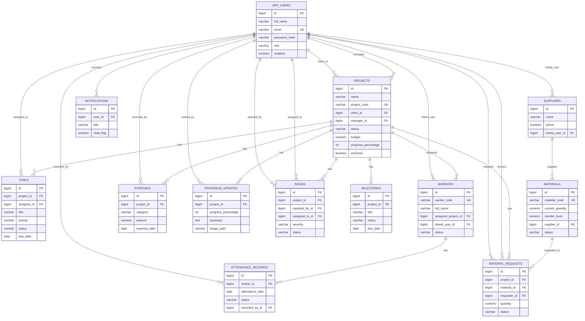

# ER diagram — BuildFlow

Mermaid entity-relationship diagram (compatible with GitHub / many Markdown previewers).

## Cardinality notes

- One CLIENT user can own many projects (`client_id`).
- One worker may have many attendance rows, but **at most one per calendar day** (unique constraint).
- Materials optionally reference one supplier; many materials can share a supplier.
